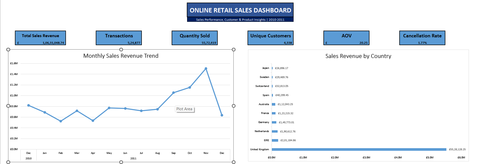
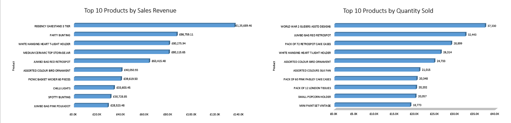
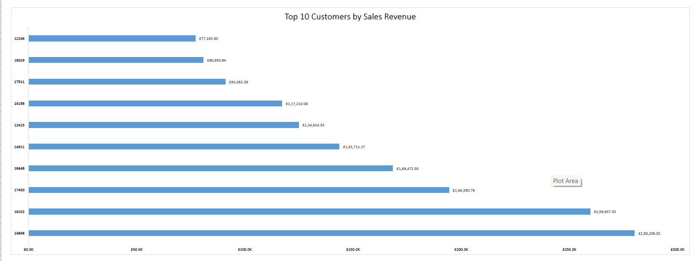
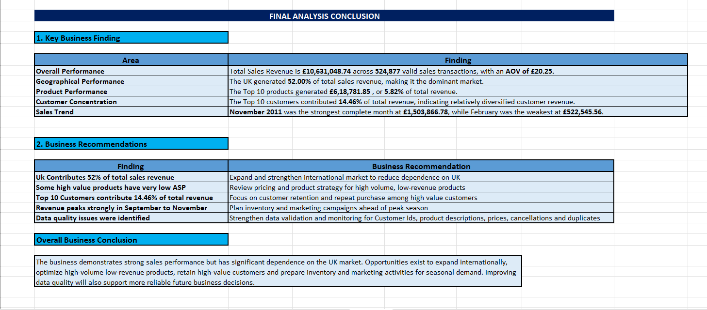

# Online Retail Sales Analysis | Excel Project

**Turning raw retail transaction data into meaningful business insights using Microsoft Excel.**

## About the Project

This project explores an online retail dataset to understand how sales revenue is distributed across products, customers, countries, and time periods. It also examines the quality of the underlying data before using it for business analysis.

The project follows a practical analytics workflow, starting with data profiling and quality investigation, moving through data preparation and analysis, and ending with a dashboard and business recommendations.

**Project stage:** Version 1 — Excel  
**Primary tool:** Microsoft Excel

## Project Objectives

- Examine the structure and reliability of retail transaction data.
- Identify missing information, duplicate records, and unusual transactions.
- Prepare transaction data for consistent sales reporting.
- Understand revenue patterns across countries, products, customers, and months.
- Present important metrics and findings in an accessible dashboard.
- Translate analytical findings into potential business actions.

## Tools and Techniques

- **Microsoft Excel:** Data analysis, formulas, calculations, and reporting.
- **Power Query:** Data preparation and transformation.
- **Pivot Tables and Pivot Charts:** Summarizing and comparing transaction data.
- **Data Profiling:** Assessing completeness, uniqueness, and data characteristics.
- **Data Quality Investigation:** Examining data anomalies before analysis.
- **Dashboard Design:** Presenting key performance indicators and sales patterns.

## Analytical Workflow

### 1. Data Profiling

The initial assessment examined the dataset's size, fields, unique values, missing information, date range, and unusual numerical values. This provided a baseline for understanding the data before making transformations.

### 2. Data Quality Investigation

Potential quality problems were investigated, including:

- Missing customer identifiers
- Cancelled invoice records
- Negative quantities
- Zero or negative unit prices
- Missing product descriptions
- Duplicate transaction rows
- Unusual adjustment records

The objective was to distinguish data quality problems from records that required separate business interpretation.

### 3. Data Preparation

Power Query was used to prepare the data for analysis. Exact duplicate rows were removed, while unusual records were investigated rather than automatically treating every anomaly as a valid sale.

The original dataset was retained separately from the prepared data to preserve the distinction between source data and transformed data.

### 4. Sales Analysis

The analysis examined several business dimensions:

- Revenue performance over time
- Revenue contribution by country
- Products ranked by sales revenue
- Products ranked by quantity sold
- Customers ranked by sales revenue

A transaction-level sales flag was used to define the valid sales population for the project's revenue analysis.

### 5. Dashboard and Reporting

The Excel dashboard brings the main performance measures and visual comparisons together. A separate final analysis report summarizes the principal findings and connects them to business recommendations.

## Key Results

The following figures reflect the current workbook and its defined sales filters.

| Metric | Result |
|---|---:|
| Original dataset records | 541,909 |
| Sales revenue | £10,631,048.74 |
| Valid sales transaction rows | 524,877 |
| Quantity sold | 5,572,419 |
| Unique customers in the sales analysis | 4,338 |
| Average order value (AOV) | £20.25 |

These metrics should be interpreted according to the project's transaction definitions. In particular, valid sales transaction rows represent qualifying rows, not necessarily distinct invoice numbers.

## Data Quality Results

The investigation identified the following issues in the original dataset:

| Finding | Records |
|---|---:|
| Rows with missing Customer IDs | 135,080 |
| Cancelled transaction rows | 9,288 |
| Rows with negative quantities | 10,624 |
| Rows with zero or negative unit prices | 2,517 |
| Rows with blank product descriptions | 1,454 |
| Excess exact duplicate rows removed | 5,268 |

These categories describe separate checks and may overlap. They should not be added together to calculate a total number of affected records.

## Business Findings

### Geographic contribution

The United Kingdom accounted for approximately 52% of the sales revenue calculated in this project. This makes the UK an important market to monitor when assessing overall performance and geographic concentration.

### Product performance

The ten highest-revenue products generated £618,781.85, equivalent to approximately 5.82% of total sales revenue. Comparing product revenue with quantity sold can help identify products that perform differently across these measures.

### Customer contribution

The ten highest-revenue customers contributed approximately 14.46% of total sales revenue. This provides a starting point for examining customer concentration and evaluating retention opportunities.

### Seasonal pattern

November 2011 was the strongest complete month in the analyzed period, generating £1,503,866.78 in sales revenue. February 2011 was the weakest complete month, at £522,545.56. December 2011 covers only the period available through 9 December, so it is not directly comparable with a full month.

## Business Recommendations

Based on the analysis, the following actions could be investigated:

1. **Assess geographic concentration:** Evaluate opportunities in other markets without assuming that expansion will automatically be profitable.
2. **Review product performance:** Compare revenue and quantity sold to identify products that may benefit from pricing, promotion, or assortment reviews.
3. **Study high-value customers:** Explore repeat-purchase behavior and retention opportunities among customers contributing substantial revenue.
4. **Plan for seasonal demand:** Use historical monthly patterns as an input to inventory and marketing planning, while validating them against additional periods.
5. **Improve data controls:** Strengthen validation of customer identifiers, product descriptions, quantities, prices, and duplicate records.

These are potential business actions derived from the observed patterns, not outcomes proven by the analysis.

## Project Screenshots

### Sales Dashboard

### Final Analysis and Business Recommendations

*If your actual screenshot filenames differ, update the image paths above to match the names in your repository.*

## Dataset Source

The project uses the **Online Retail** dataset published by the UCI Machine Learning Repository.

Source: [UCI Machine Learning Repository — Online Retail](https://archive.ics.uci.edu/dataset/352/online+retail)

The source dataset is separate from the analysis workbook. Refer to the dataset's terms before redistributing the original data.

## Limitations and Future Development

This first version focuses on Excel-based analysis. The findings depend on the selected transaction filters and the period covered by the dataset. The analysis is descriptive and does not establish the causes of observed sales patterns.

Planned extensions include:

- Reproducing key calculations and analysis in SQL.
- Developing an interactive Power BI dashboard.
- Adding further validation and business metrics.
- Comparing results across tools to check consistency.

SQL and Power BI are future extensions, not tools used to produce this version.

## Author

**Krishna Chandrapal**  
BSc IT — Data Science

This project represents a practical exercise in Excel-based data preparation, data quality assessment, sales analysis, and business reporting.
